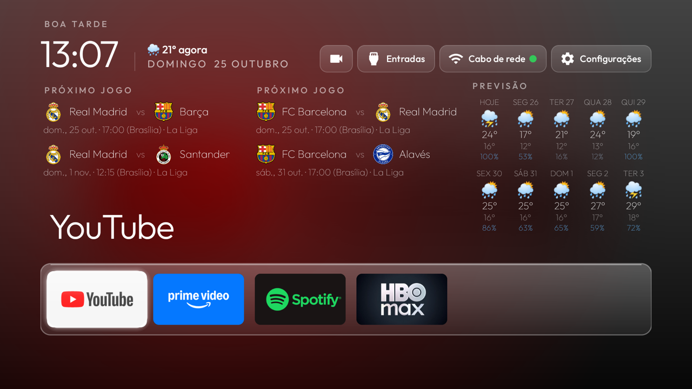
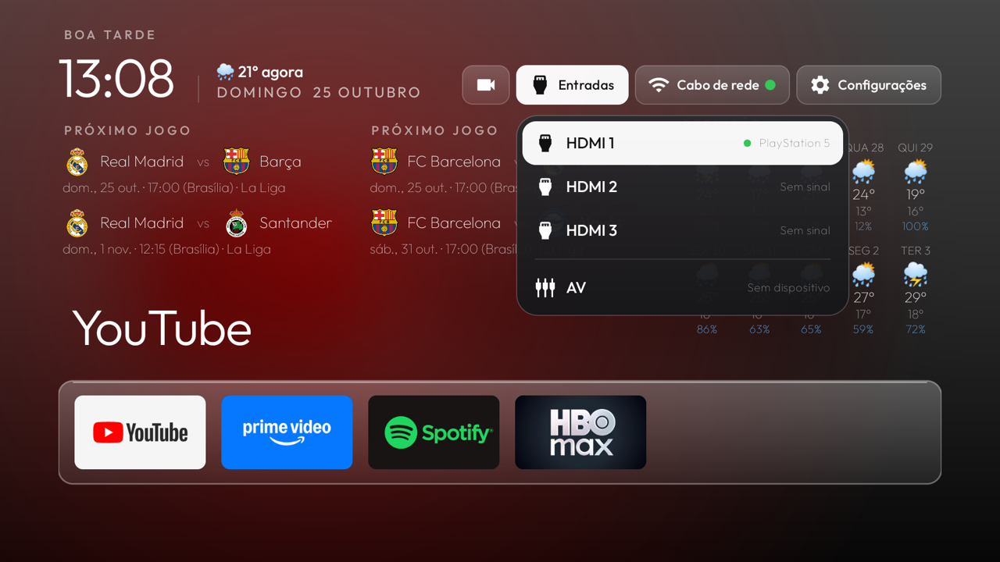

# tv-os-smart

Tela inicial (launcher) para **Android TV / Google TV**: preta, rápida e **sem anúncios**. Troca a home do Google por uma
só com os seus apps e põe na própria tela inicial o que você olha toda hora: **previsão do tempo, próximos jogos dos seus
times e as câmeras de segurança ao vivo** (de qualquer marca que fale RTSP).

Feito em cima do launcher [dhruv2003/sony-tv-launcher](https://github.com/dhruv2003/sony-tv-launcher) (MIT). Veja
[Créditos](#créditos).



## Índice

- [O que tem](#o-que-tem)
- [Como usar](#como-usar)
- [Configuração](#configuração)
- [Câmeras](#câmeras)
- [Modo ambiente](#modo-ambiente)
- [Entradas HDMI](#entradas-hdmi)
- [Atalhos do controle](#atalhos-do-controle-qualquer-app)
- [Estrutura do projeto](#estrutura-do-projeto)
- [Compilar e instalar](#compilar-e-instalar)
- [Segurança e privacidade](#segurança-e-privacidade)
- [Créditos](#créditos)

---

## O que tem

| Recurso | O que faz |
|---|---|
| **Barra de apps** | Uma linha de ponta a ponta, em vidro, que **rola para o lado** quando você instala mais apps. O app em foco mostra o nome grande e um fundo na cor dele |
| **Relógio e saudação** | Bom dia, boa tarde, boa noite, com a data e a temperatura de agora |
| **Previsão de 10 dias** | Máxima, mínima, ícone do tempo e chance de chuva de cada dia, para a cidade que você escolher (Open-Meteo, **sem chave**) |
| **Próximos jogos** | Até dois times, com escudo, nome, campeonato e horário de Brasília. A lista se atualiza sozinha quando um jogo passa (football-data.org) |
| **Câmeras ao vivo** | Qualquer câmera RTSP, de **qualquer marca**, e um **mosaico** com todas ao mesmo tempo. Câmeras de duas lentes aparecem em tela dividida |
| **Modo ambiente** | Depois de alguns minutos parado, mostra só relógio, previsão e jogos num fundo escuro |
| **Entradas HDMI** | Lista as portas reais da TV e mostra, em cada uma, o nome do aparelho ligado nela (PlayStation, soundbar...) |
| **Atalhos do controle** | Um botão abre as câmeras e outro volta para a tela inicial, **em qualquer app** |
| **Rede** | Mostra "Cabo de rede" ou o nome do Wi-Fi, com uma bolinha verde (internet ok) ou vermelha |
| **Idiomas** | Português do Brasil e inglês (segue o idioma da TV) |

Sem anúncios, sem rastreio e sem análise de uso. O app usa a internet só para a previsão, os jogos e os escudos.

---

## Como usar

- **Tela inicial:** use as setas. **OK** abre o app. **Segurar OK** num app abre o menu: mover, tirar dos favoritos, informações.
- **Menu** (botão do controle) ou o botão **Configurações** do topo: painel de configurações rápidas (Wi-Fi, som, imagem,
  temporizador e as opções do próprio launcher).
- **Botão da câmera** (primeiro da barra de cima): abre o visualizador de câmeras.
- **Entradas:** abre a lista de HDMI e AV.



---

## Configuração

Nada de pessoal fica no código. Cidade, times, chave da API, câmeras e atalhos ficam num arquivo **que o git ignora**:

```bash
cp personal.example.properties personal.properties
# edite personal.properties e compile de novo
```

**Tudo é opcional.** O que ficar vazio simplesmente não aparece no app: sem `cameras`, o botão de câmeras some; sem
`weather_lat` e `weather_lon`, a previsão some; sem `teams` ou sem chave, os jogos somem.

| Chave | Para que serve | Exemplo |
|---|---|---|
| `football_api_key` | Token grátis do [football-data.org](https://www.football-data.org/client/register) | `abc123...` |
| `teams` | Até dois times: `chave\|nome\|id do time\|competições`, separados por `;` | `rm\|Real Madrid\|86\|PD,CL` |
| `team_names` | Como escrever os clubes: `short` (padrão: Barça, Racing), `full` (nome completo) ou `tla` (sigla de 3 letras) | `short` |
| `goal_alerts` | Aviso de gol por cima de qualquer app, dos dois lados, com um som suave: `on` (padrão) ou `off`. Precisa do serviço de acessibilidade ligado (veja [Atalhos](#atalhos-do-controle-qualquer-app)). O plano grátis do football-data.org entrega o placar com atraso | `on` |
| `weather_lat`, `weather_lon`, `weather_city` | Local da previsão. A cidade só aparece no título se você preencher | `-23.55`, `-46.63`, `São Paulo` |
| `ambient_minutes` | Minutos parado até o modo ambiente. `0` desliga, vazio = 5 | `5` |
| `hidden_apps` | Pacotes que ficam fora da barra de apps, separados por vírgula | `com.exemplo.app` |
| `key_cameras`, `key_home` | Botões do controle para os atalhos (veja [Atalhos](#atalhos-do-controle-qualquer-app)) | `scan:52` |
| `cameras` | As suas câmeras (veja [Câmeras](#câmeras)) | veja abaixo |

**Jogos:** o plano grátis do football-data.org cobre alguns campeonatos (por exemplo La Liga `PD`, Champions League `CL`,
Brasileirão `BSA`, Premier League `PL`). Jogos de outros campeonatos, como copas nacionais, não aparecem. O id do time está
na página do time no site deles (Real Madrid 86, FC Barcelona 81).

---

## Câmeras

Funciona com **qualquer câmera que ofereça vídeo por RTSP**, de qualquer marca: Tapo, Yoosee, Intelbras, Hikvision, Dahua,
Reolink, Imou, câmeras ONVIF genéricas, e o que mais falar RTSP. O vídeo vai pelo motor do VLC.

Você cadastra cada câmera em `personal.properties`, na chave `cameras`, uma por entrada, separadas por `;`:

```
chave|nome|host|caminho|usuário padrão|lentes|caminho do mosaico
```

| Campo | O que é |
|---|---|
| `chave` | Um id curto. A conta salva da câmera fica guardada com ele, então **não mude** se reordenar a lista |
| `nome` | O nome que aparece na tela |
| `host` | O IP da câmera na sua rede (fixe o IP no roteador) |
| `caminho` | O caminho do vídeo RTSP (ex.: `/stream1`). Cada marca usa o seu, veja a tabela abaixo |
| `usuário padrão` | Usuário que já vem preenchido ao cadastrar a conta (opcional) |
| `lentes` | Vazio para câmera normal. Para câmera de **duas lentes** que manda as duas numa imagem só (uma em cima da outra), escreva `Nome 1,Nome 2` e ela aparece em tela dividida |
| `caminho do mosaico` | Um vídeo mais leve, só para o mosaico (opcional; vazio = o mesmo caminho) |

Exemplo:

```properties
cameras=entrada|Entrada|192.168.1.50|/stream1|||/stream2;quintal|Quintal|192.168.1.51|/onvif2|admin|Esquerda,Direita
```

**Caminhos mais comuns** (confirme no manual da sua câmera, pois mudam por modelo e firmware):

| Marca | Caminho típico |
|---|---|
| TP-Link Tapo | `/stream1` (alta), `/stream2` (leve) |
| Yoosee (e câmeras com chip parecido) | `/onvif1`, `/onvif2` |
| Hikvision | `/Streaming/Channels/101` |
| Dahua / Intelbras | `/cam/realmonitor?channel=1&subtype=0` |
| Reolink | `/h264Preview_01_main` |

### Senhas

**A senha nunca vai no arquivo.** Você digita na própria TV: abra o botão de câmeras, escolha a câmera e aperte **Menu**.
Ela fica só no armazenamento privado do launcher. Câmeras que têm um usuário e senha de **câmera** separados do login do
aplicativo (a Tapo é assim: "Conta da câmera" nas configurações avançadas) precisam disso ligado antes. A porta de vídeo
só abre depois que essa conta existe.

### Como navegar

- **← →** trocam de câmera. Depois da última, vem o **Mosaico**, com todas as câmeras e lentes ao mesmo tempo, sem áudio.
- **Menu** edita a conta da câmera que está na tela. **Voltar** sai.
- A **última imagem** de cada câmera de duas lentes fica guardada e aparece na hora, escurecida, enquanto o vídeo ao vivo
  conecta. Algumas câmeras levam alguns segundos para mandar o primeiro quadro completo.

### Problemas comuns

**A câmera fica preta ou some do app.**

- **O IP mudou.** O app guarda o IP na hora de compilar. Se o roteador entregar outro número para a câmera, ela deixa de
  abrir. Reserve o IP de cada câmera no roteador (DHCP reservado, ou "reserva de endereço" no app do seu roteador). Se já
  mudou, corrija o `host` em `personal.properties`, compile de novo e reinstale.
- **O IP está na câmera errada.** Para saber qual IP é de qual marca, peça o vídeo sem senha e leia a resposta de
  autenticação (`401`). Troque `IP` pelo da câmera:

  ```bash
  printf 'DESCRIBE rtsp://IP:554/stream1 RTSP/1.0\r\nCSeq: 1\r\n\r\n' | nc -w3 IP 554
  ```

  `realm="TP-Link IP-Camera"` é Tapo. `realm="HIipCamera"` é Yoosee. Sem resposta nenhuma, a porta 554 está fechada: o
  RTSP está desligado na câmera, ou o aparelho nem é uma câmera.
- **Login recusado** (no log aparece `Failed to setup RTSP session`). A câmera está no ar e responde, mas rejeitou o usuário
  ou a senha. Veja a próxima dica.

**Qual usuário e senha usar.** Nunca é o login do aplicativo da marca (o e-mail da conta). É a **conta da câmera**:

- **Tapo:** crie uma conta nova em Configurações > Avançado > Conta da câmera, em cada câmera.
- **Yoosee:** é a senha definida ao ligar o RTSP / conexão NVR, que pode ser diferente da senha da conta.

Depois de criar a conta na câmera, **reinicie a câmera**. Algumas só passam a aceitar o login (e a abrir a porta 554) depois
disso. Digite o mesmo usuário e senha na TV (**Menu** na câmera) e teste de novo.

**Sinal fraco.** Se o ping até a câmera passa de algumas dezenas de milissegundos ou oscila muito, o Wi-Fi dela está ruim e
o vídeo trava ou não conecta. Aproxime o ponto de acesso da câmera ou use um repetidor.

---

## Modo ambiente

Depois de alguns minutos sem apertar nada na tela inicial (5 por padrão), a tela mostra só o essencial, sobre um degradê
verde-escuro:

- **à esquerda:** relógio grande, data, temperatura de agora e a previsão de 10 dias;
- **à direita:** os próximos jogos, com escudos.

**Qualquer tecla** volta para a tela inicial, e essa tecla não faz mais nada. O conteúdo anda alguns pixels a cada minuto
para nada ficar aceso no mesmo ponto. Ele não aparece com o painel de configurações aberto nem dentro das câmeras.

Se você quiser usar só este modo, desligue o protetor de tela de fábrica da TV:

```bash
adb shell settings put secure screensaver_enabled 0
adb shell settings put secure screensaver_activate_on_sleep 0
adb shell pm disable-user --user 0 com.google.android.backdrop    # Google TV; para desfazer: pm enable
```

---

## Entradas HDMI

O botão **Entradas** lista as portas reais da TV (HDMI 1, 2, 3 e AV). Se a TV conhece o aparelho ligado numa porta, o nome
aparece na própria porta, com um ponto verde:

```
HDMI 1   ● PlayStation 5
HDMI 2        Sem sinal
HDMI 3        Sem sinal
AV            Sem dispositivo
```

O nome vem do HDMI-CEC, então depende do aparelho e da TV falarem CEC.

**Importante:** trocar de entrada é feito pelo app de TV da própria TV (na linha MediaTek, `com.mediatek.wwtv.tvcenter`).
**Não desative esse app.** Se ele não deve aparecer na barra de apps, use `hidden_apps` em vez de desativá-lo. Sem ele,
clicar numa porta HDMI dá "indisponível".

---

## Atalhos do controle (qualquer app)

Dois botões do controle podem funcionar em **qualquer tela da TV**, mesmo dentro de outro app: um abre as câmeras e outro
volta para a tela inicial. Você escolhe em `personal.properties`:

```properties
key_cameras=scan:52,scan:167
key_home=KEYCODE_TV_INPUT
```

Cada botão é um nome do Android (`KEYCODE_TV_INPUT`), um número, ou `scan:NNN`, que é o código físico da tecla e não
depende de como o Android a chama. Dá para listar vários, separados por vírgula. Com `long:` na frente
(`long:KEYCODE_MENU`), vale **segurar** o botão, e o toque curto continua indo para o app aberto.

**Descobrir o código de um botão:** com a TV na mesma rede e o ADB ligado, rode `adb shell getevent -lt` e aperte o botão.
Aparece algo como `KEY_DOT` e o código de varredura (`MSC_SCAN`).

Para um app ver teclas enquanto outro está na tela, o Android exige um **serviço de acessibilidade**. Ligue-o uma vez:

```bash
adb shell settings put secure enabled_accessibility_services dev.dhruv.tvhome/dev.dhruv.tvhome.KeyWatcherService
adb shell settings put secure accessibility_enabled 1
```

Ou em Configurações → Acessibilidade. **Leia antes de ligar:** um serviço desses *poderia* ver todas as teclas, inclusive
senhas digitadas com o controle. O código (`KeyWatcherService.java`, umas 90 linhas) reage só aos botões que você
configurou, não anota nenhuma tecla e deixa todas as outras passarem. Um botão que vira atalho **deixa de chegar** aos
outros apps; se precisar dele, use `long:`.

---

## Estrutura do projeto

```
app/src/main/
  java/dev/dhruv/tvhome/
    MainActivity.java       # tela inicial: barra de apps, topo, entradas HDMI, ligação de tudo
    AppAdapter.java         # lista e ordem dos apps (favoritos, recentes, rolagem lateral)
    DockDecoration.java     # a barra de vidro atrás dos apps
    Weather.java            # previsão de 10 dias e temperatura de agora (Open-Meteo)
    NextMatch.java          # próximos jogos de um time (football-data.org), com cache
    AmbientView.java        # modo ambiente
    CameraActivity.java     # câmeras ao vivo, tela dividida e mosaico (libVLC)
    KeyWatcherService.java  # atalhos do controle em qualquer app (acessibilidade)
    ImageLoader.java        # escudos e imagens
  res/values/               # textos em inglês
  res/values-pt-rBR/        # textos em português do Brasil
scripts/install.sh          # instala na TV por ADB
personal.example.properties # modelo da configuração pessoal
docs/images/                # prints deste README
```

---

## Compilar e instalar

Precisa de **JDK 17** e do **Android SDK** (plataforma 34 e build-tools 34). Crie `local.properties` com o caminho do SDK
(o git ignora):

```properties
sdk.dir=/caminho/para/o/android-sdk
```

```bash
./gradlew assembleRelease
# app/build/outputs/apk/release/app-release.apk
```

O APK fica com uns 40 MB por causa do VLC. Ele inclui só a arquitetura **armeabi-v7a** (TVs de 32 bits). Para uma TV de 64
bits, troque o `abiFilters` em `app/build.gradle.kts` por `arm64-v8a`. Para saber a da sua:
`adb shell getprop ro.product.cpu.abilist`.

**Instalar na TV:** Configurações → Sistema → Sobre → aperte OK 7 vezes em "Build" → Opções do desenvolvedor → ligue a
depuração (USB/ADB). Com a TV na mesma rede:

```bash
scripts/install.sh 192.168.1.50
```

Aceite o aviso "Permitir depuração" na TV na primeira vez. O script instala, dá a permissão de localização (para mostrar o
nome do Wi-Fi) e define o launcher como tela inicial. **Desligue a depuração depois de instalar**, porque o ADB por Wi-Fi não
é criptografado.

### Tornar a tela inicial

Se o botão Home ainda abrir a tela antiga, desative a home do Google (reversível):

```bash
adb shell cmd package query-activities --brief -a android.intent.action.MAIN -c android.intent.category.HOME
adb shell pm disable-user --user 0 com.google.android.tvlauncher     # ou o pacote que aparecer na lista
# para desfazer:
adb shell pm enable com.google.android.tvlauncher
```

---

## Segurança e privacidade

- O repositório **não tem** chaves, endereços da sua rede, logins nem senhas. `personal.properties` e `local.properties`
  estão no `.gitignore`.
- Os dados pessoais entram na hora de compilar, a partir de `personal.properties`. **Um APK compilado com o seu arquivo
  carrega esses dados** (chave da API, IPs das câmeras). Não publique esse APK.
- O launcher usa a internet só para: previsão (Open-Meteo), jogos (football-data.org) e escudos dos times.
- As senhas das câmeras ficam só no armazenamento privado do app, digitadas na TV.
- O pacote continua `dev.dhruv.tvhome`, o do projeto original.

---

## Créditos

- Base: [dhruv2003/sony-tv-launcher](https://github.com/dhruv2003/sony-tv-launcher) (MIT), que usa a interface do
  [tv-vibehack](https://github.com/Gathin23/tv-vibehack) de Gathin (MIT). Veja `LICENSE` e `LICENSE-tv-vibehack.txt`.
- Fonte Outfit (SIL OFL 1.1): `FONT-LICENSE-OFL.txt`.
- Vídeo das câmeras: [libVLC](https://www.videolan.org/vlc/libvlc.html) (LGPL 2.1).
- Previsão: [Open-Meteo](https://open-meteo.com). Jogos: [football-data.org](https://www.football-data.org).

## Licença

MIT, a mesma do projeto original. Veja [LICENSE](LICENSE).
